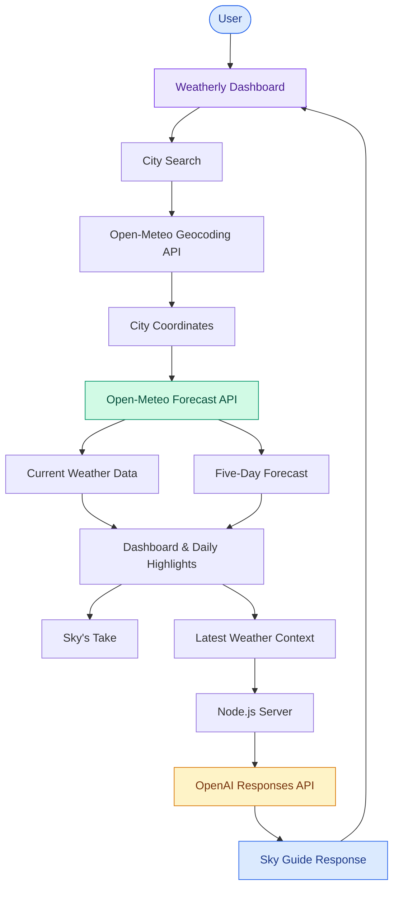

# ☁️ Weatherly — Your AI-Powered Weather Companion

<p align="center">
  <b>More than a weather forecast. A smarter way to understand the sky.</b>
</p>

<p align="center">
  
  
  
  
</p>

---

## 🌤️ Overview

**Weatherly** is a responsive, AI-powered weather dashboard designed to make weather information more interactive, accessible, and meaningful.

Opening with **Delhi** by default, Weatherly allows users to search for any supported city and explore its real-time weather conditions, daily highlights, five-day forecast, and personalized weather insights.

What makes Weatherly different is **Sky Guide** — an AI-powered weather assistant that goes beyond displaying numbers. It uses the latest weather data loaded by the dashboard to answer questions, explain weather conditions, and describe expected changes over the next five days.

Whether you're planning your day, preparing for changing weather, or simply curious about atmospheric conditions, Weatherly brings weather data and conversational AI together in one interface.

## ✨ Key Features

### 🌍 1. Live Weather & City Search
- Opens with Delhi as the default location.
- Search for different cities using Open-Meteo Geocoding API.
- Fetch current weather conditions and forecasts.
- Dynamically update the dashboard based on the selected city.

### 🌡️ 2. Real-Time Weather Insights

View essential weather parameters through an intuitive dashboard:

| Parameter | Description |
|---|---|
| Temperature | Current atmospheric temperature |
| Feels Like | Perceived temperature |
| Humidity | Relative humidity percentage |
| Wind Speed | Current wind conditions |
| Rain Chance | Probability of precipitation |

### 📅 3. Five-Day Weather Forecast
- View upcoming weather conditions for five days.
- Understand expected temperature changes.
- Explore forecast trends before planning outdoor activities.

### 💡 4. Sky's Take

A weather-aware insight section that provides a short, contextual suggestion based on the selected city's weather conditions.

Instead of simply displaying raw values, Weatherly makes the forecast easier to interpret and act upon.

### 🤖 5. Sky Guide — AI Weather Assistant

Meet Sky Guide, your conversational weather companion.

Powered by the **OpenAI Responses API**, Sky Guide uses the latest weather data loaded in the dashboard to answer questions such as:

- Should I carry an umbrella today?
- Why does it feel hotter than the actual temperature?
- How will the weather change over the next five days?
- Is tomorrow suitable for outdoor activities?
- What should I expect from the current wind and humidity conditions?

**Key capabilities:**
- Context-aware weather conversations.
- Explanations of current weather conditions.
- Five-day forecast interpretation.
- Natural-language weather assistance.

Sky Guide is designed to answer using the dashboard's available weather context rather than treating every question as an unrestricted general-purpose AI query.

---

## 🏗️ System Architecture

Weatherly combines external weather APIs, a responsive frontend, a Node.js server, and an AI-powered conversational interface.

### High-Level Architecture



### How It Works

1. **User Interaction:** The user opens Weatherly or searches for a city.
2. **Geocoding:** The Open-Meteo Geocoding API resolves the selected city into geographical coordinates.
3. **Weather Retrieval:** The Open-Meteo Forecast API provides current conditions and upcoming forecast data.
4. **Dashboard Rendering:** The frontend displays weather metrics, highlights, and the five-day forecast.
5. **Context Preparation:** The latest weather data loaded by the dashboard is made available to Sky Guide.
6. **AI Response Generation:** The Node.js server securely forwards the chat request and weather context to the OpenAI Responses API.
7. **Conversational Output:** Sky Guide returns a contextual answer through the dashboard.

---

## 🛠️ Tech Stack

| Technology | Purpose |
|---|---|
| HTML5 | Dashboard structure |
| CSS3 | Responsive styling and layout |
| JavaScript | Frontend interactions and API integration |
| Node.js | Backend runtime |
| Open-Meteo Geocoding API | City search and geographical coordinates |
| Open-Meteo Forecast API | Weather conditions and forecasts |
| OpenAI Responses API | AI-powered weather conversations |
| Environment Variables | Secure API key management |

---

## 📂 Project Structure

```text
Weatherly/
│
├── index.html          # Dashboard interface and browser-side logic
│
├── style.css           # Responsive UI and visual styling
│
├── server.js           # Node.js server and protected AI API route
│
├── .env.example        # Environment variable template
│
├── .gitignore          # Excludes sensitive and unnecessary files
│
└── README.md           # Project documentation
```

---

## 🚀 Getting Started

Follow these steps to run Weatherly locally.

### Prerequisites

Make sure you have:

- Node.js version 20 or newer.
- npm (included with Node.js).
- An OpenAI API key with available API credits to use Sky Guide.

**Note:** Weather search and forecasting work without an OpenAI API key. The AI assistant requires one.

### 1. Clone the Repository

```bash
git clone YOUR_GITHUB_REPOSITORY_URL
```

### 2. Navigate to the Project Directory

```bash
cd Weatherly
```

### 3. Configure Environment Variables

Copy the example environment file:

```bash
cp .env.example .env
```

Open `.env` and configure your OpenAI API key:

```env
OPENAI_API_KEY=your_openai_api_key_here
```

Replace the placeholder with your actual API key.

### 4. Start the Application

```bash
npm start
```

No additional npm dependencies need to be installed for this project.

### 5. Open Weatherly

Navigate to:

```text
http://localhost:3000
```

Your Weatherly dashboard should now be running!

**Important:** If you modify `.env` while the server is running, restart the server using `npm start` to reload the API key.

---

## 🔐 Security & API Key Management

Weatherly uses a server-side API route to communicate with OpenAI.

Security practices:

- OpenAI API keys are stored in environment variables.
- API requests are handled through the Node.js backend.
- The API key is not embedded in `index.html`.
- The `.env` file should never be committed to GitHub.
- The `.env.example` file provides a safe configuration template.

Never expose your OpenAI credentials in browser-side JavaScript or public repositories.

---

## 🌐 API Integrations

### Open-Meteo

Used for city geocoding, current weather information, and forecast retrieval.

- [Open-Meteo Geocoding API](https://open-meteo.com/en/docs/geocoding-api)
- [Open-Meteo Forecast API](https://open-meteo.com/en/docs)

### OpenAI

Used to power Sky Guide's conversational weather assistance through the Responses API.

- [OpenAI API Documentation](https://platform.openai.com/docs/overview)
- [OpenAI Responses API](https://platform.openai.com/docs/api-reference/responses)

---

## 🚢 Deployment

Weatherly can be deployed as a **Node.js web service**.

### Deployment Requirements

- Build/runtime: Node.js 20 or newer.
- Start command: `npm start`.
- Environment variable: `OPENAI_API_KEY`.

### Important Deployment Note

Weatherly includes a backend `/api/chat` route that communicates with OpenAI.

Therefore, it must be deployed on a platform capable of running a Node.js server.

A static-only hosting service cannot independently execute the `/api/chat` backend route.

Configure `OPENAI_API_KEY` through your hosting provider's environment-variable settings. Do not upload `.env` to your deployment repository.

---

## 🔮 Future Enhancements

Potential directions for extending Weatherly include:

- Interactive weather maps and radar visualization.
- Hourly weather forecasts.
- Weather-based travel recommendations.
- Air quality and UV index monitoring.
- Severe weather alerts.
- Location-based personalized notifications.
- Conversation history for Sky Guide.
- More advanced weather-context reasoning.

---

## 👨‍💻 Author

**Priyanshu Kumar**

Mathematics & Computing | Delhi Technological University (DTU)

GitHub: [@priyanshukr001](https://github.com/priyanshukr001)

---

<p align="center">
  <b>☀️ Weather changes. Plans evolve. Stay one step ahead with Weatherly.</b>
</p>

<p align="center">
  ⭐ If you like this project, consider giving the repository a star!
</p>
